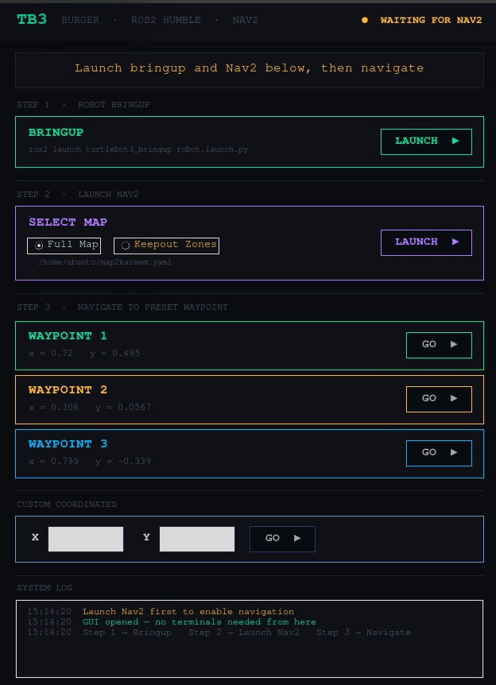
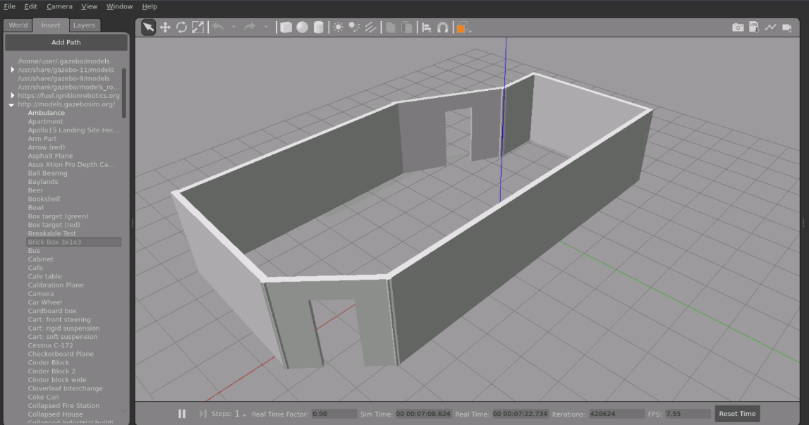
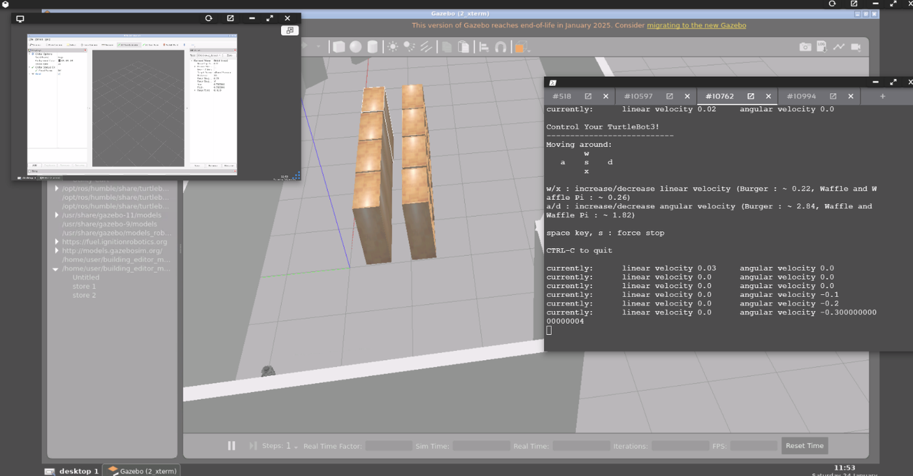
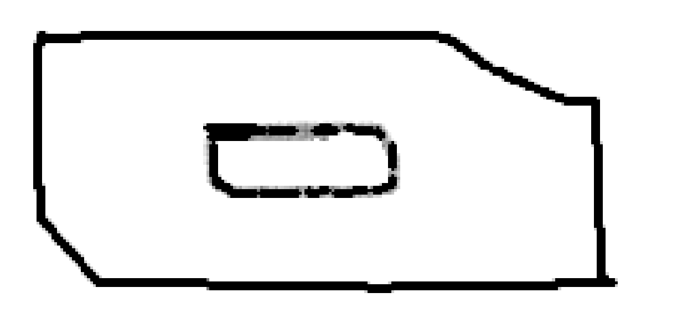

# TurtleBot3 Autonomous Navigation — ROS 2 Humble, Cartographer SLAM, Nav2 & Operator GUI

**Robotics Operating System module · Asia Pacific University · 2026**

The full autonomous-robot pipeline on a **TurtleBot3 Burger**: build a world, map it with SLAM, navigate it autonomously with Nav2, and give a non-technical operator a one-window GUI to send the real robot to set points.

## Highlights

- Designed a **custom Gazebo convenience-store world** with 6 shelving racks, cylindrical product stands, 3 standing-person obstacles and two entrances.
- Mapped it with **Google Cartographer**: a **165 × 79 cell occupancy grid at 0.05 m/cell** with sharp walls and no visible drift in the repetitive aisles. I chose Cartographer over SLAM Toolbox in a written trade-off study.
- Wrote **`go_to_exit.py`** (Nav2 `BasicNavigator` API). It drives the robot to the exit and back to the origin with **zero human input after launch**. Nav2's recovery manager cleared **3 narrow-aisle deadlocks** on its own, and the task returned `SUCCEEDED`.
- Built **`burger_gui.py`**, a Tkinter + rclpy operator GUI for the **physical robot**. On the real arena, **all 3 preset waypoints and a custom-coordinate goal returned `SUCCEEDED`**.

## Operator GUI (physical robot)



**Three-step workflow:**
1. **Bringup** launches the TurtleBot3 hardware drivers.
2. **Select map + launch Nav2**: choose the full map or a keep-out-zone map.
3. **Navigate** to a preset waypoint or to custom (x, y) coordinates.

**Design decisions:**
- **Navigation buttons stay locked until Nav2 is active.** A background daemon thread polls Nav2 and unlocks them. This prevents the most common Nav2 failure: a goal sent too early is rejected silently and the robot just sits there.
- Goals run on a worker thread, and status updates go back through `root.after()`, so the window never freezes during a run.
- Custom coordinates are validated. Invalid input turns the fields red for 1.5 s and is written to the log.
- A status header shows `WAITING FOR NAV2`, `NAV2 ACTIVE` or `NAVIGATING`, and a timestamped system log records every action and its result.
- Each goal is a `PoseStamped` in the `map` frame, dispatched with `goToPose()`. The GUI polls `isTaskComplete()`, then reads `getResult()` → `TaskResult`.

| Waypoint | x (m) | y (m) |
|---|---|---|
| 1 | 0.720 | 0.495 |
| 2 | 0.306 | 0.0567 |
| 3 | 0.799 | −0.339 |

### Maps: full arena vs keep-out zones


*Left: full arena map (`map2kareem`). Right: keep-out map (`map3kareemkeepout`).*

Both maps are 0.05 m/cell with origin (−1.45, −1.38) and are in [`maps/`](maps). The keep-out version adds virtual walls that Nav2 plans around, which is how the keep-out-zone task was met without changing the physical arena.

### Run it on the robot

```bash
# one terminal is enough: the GUI opens the others for you
source /opt/ros/humble/setup.bash
export TURTLEBOT3_MODEL=burger
python3 src/burger_gui.py
#  Step 1  LAUNCH  → ros2 launch turtlebot3_bringup robot.launch.py          (new terminal)
#  Step 2  LAUNCH  → ros2 launch turtlebot3_navigation2 navigation2.launch.py map:=<selected map> use_sim_time:=false
#  Step 3  GO      → unlocks automatically once Nav2 is active
```

Source: [`src/burger_gui.py`](src/burger_gui.py). Map paths default to this repo's `maps/` folder and can be overridden with the `MAP_FULL` and `MAP_KEEPOUT` environment variables.

## Simulation: world → SLAM → autonomous navigation

| Gazebo store world | Mapping with LiDAR + teleop |
|---|---|
|  |  |

| Cartographer occupancy grid | Physical arena map |
|---|---|
|  |  |

### Why Cartographer over SLAM Toolbox

| | Cartographer (used) | SLAM Toolbox |
|---|---|---|
| Method | Submaps + global pose-graph loop closure (SPA) | Pose graph with lifelong mapping |
| Fit for this world | Closed layout with repeating parallel racks, where loop closure stops aisle drift | Better for large, multi-session maps |
| Setup | Lua config (`map_builder`, `trajectory_builder_2d`, `pose_graph`) | Plugs straight into the Nav2 lifecycle |

### Launch sequence

```bash
export TURTLEBOT3_MODEL=burger
gazebo ashtask1.world
ros2 launch turtlebot3_cartographer cartographer.launch.py use_sim_time:=True
ros2 run turtlebot3_teleop teleop_keyboard
ros2 run nav2_map_server map_saver_cli -f ~/Mansymap
ros2 launch turtlebot3_navigation2 navigation2.launch.py map:=$HOME/Mansymap.yaml use_sim_time:=True
python3 ~/go_to_exit.py
```

### `go_to_exit.py` logic

1. Start `rclpy`, create a `BasicNavigator` and call `waitUntilNav2Active()`.
2. Build a `PoseStamped` goal in the `map` frame and dispatch it with `goToPose()`.
3. Poll `isTaskComplete()`, then check `getResult()` for `SUCCEEDED`.
4. Send a return goal to the origin (0, 0) and shut down cleanly.

## Stack

ROS 2 Humble · TurtleBot3 Burger · Gazebo · RViz2 · Google Cartographer · Nav2 (AMCL, costmaps, recovery behaviours) · `nav2_simple_commander` · Python · Tkinter · Ubuntu

## Contribution

The individual task covered the simulation: Gazebo world design, Cartographer mapping, `go_to_exit.py` and the SLAM comparison. In the group project, I owned **Sub-task 4, GUI set-point navigation** (`burger_gui.py`) on the physical robot.
